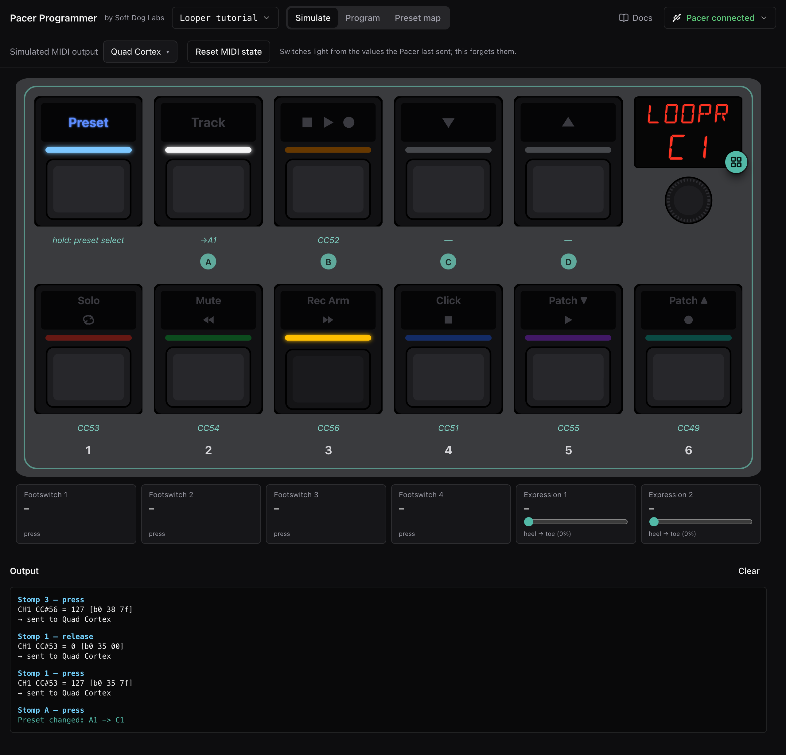

# Pacer Programmer

Pacer Programmer is a browser-based editor for the Nektar Pacer MIDI foot
controller. It's built around two ideas.

The first is that you should be able to see what a change does before you
send it. Programming my Pacer used to mean guessing at what a preset would
do, sending it to the device, stomping on switches to find out, and doing it
all again. Here you program on screen, press the switches on screen, and your
real gear responds to real MIDI. The Pacer only gets sent anything once it's
right.

In the picture it's driving a Quad Cortex's looper. The lights and the display
are what the Pacer itself would show, since the simulator runs your
configuration the way the Pacer's firmware does, and the log at the bottom
lists every message that went out.

The second idea is a little more unusual. The Pacer can't remember anything,
so if you want a switch that means "go back to wherever I came from," you end
up building copies of presets by hand and keeping them in sync forever. The
[preset map](reference/preset-map.md) finds those copies in your configuration,
shows them as the one thing you actually designed, and keeps them in step when
you change it. [Why a state machine](why-a-state-machine.md) explains the
problem in more detail.

There's no project file. The app reads and writes the Pacer's own `.syx` dump,
and the format is [documented](reference/programming-the-pacer.md) well enough
that you (or an AI) can read and write it too.

You'll need Chrome, Edge, Opera or Brave. MIDI is only needed to reach real
gear and the Pacer; everything else works without it.

## Where to start

If you're new, read [The simulator](guide/the-simulator.md) and then
[Editing a preset](guide/editing-a-preset.md). The [tutorials](tutorials/)
build my looper from the factory defaults, one step at a time. When you need to
look something up, the [reference](reference/) covers every control and every
message the app shows. And if you'd rather have an assistant do the tedious
part, see [Working with an AI](guide/working-with-ai.md).

## Contents

[Guide](guide/): how to get things done

- [The simulator](guide/the-simulator.md)
- [Editing a preset](guide/editing-a-preset.md)
- [Switches and steps](guide/switches-and-steps.md)
- [Lights and colours](guide/lights-and-colours.md)
- [MIDI sent when a preset loads](guide/preset-midi-on-load.md)
- [Saving and sending](guide/saving-and-sending.md)
- [Working with an AI](guide/working-with-ai.md)

[Tutorials](tutorials/): a looper, step by step

1. [A looper preset](tutorials/1-a-looper-preset.md)
2. [A second way in](tutorials/2-a-second-way-in.md)
3. [Changing the looper](tutorials/3-changing-the-looper.md)
4. [Letting an AI build it](tutorials/4-letting-an-ai-build-it.md)

[Reference](reference/): the manual

- [The window](reference/the-window.md)
- [The faceplate](reference/the-faceplate.md)
- [Simulate mode](reference/simulate-mode.md)
- [Program mode](reference/program-mode.md)
- [The preset map](reference/preset-map.md)
- [Devices and files](reference/devices-and-files.md)
- [Programming the Pacer](reference/programming-the-pacer.md)
- [Troubleshooting](reference/troubleshooting.md)
- [Glossary](reference/glossary.md)

[Why a state machine](why-a-state-machine.md): the problem the preset map
solves.
