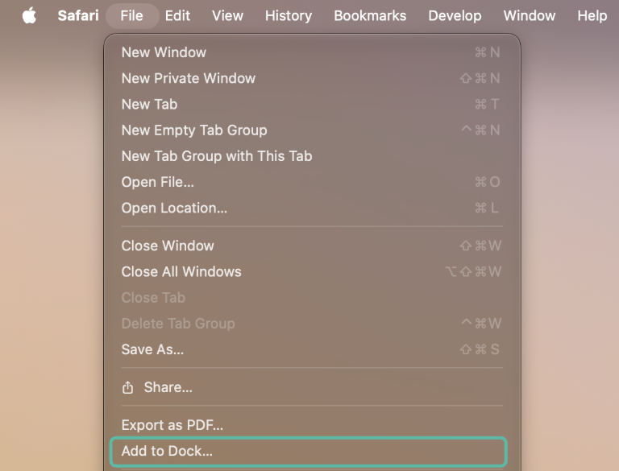

# Browsers and Installing

Pacer Programmer runs in your web browser, and keeps everything you save inside
that browser too. If your browser can't talk MIDI, or might throw away what
you've saved, the app tells you when it starts. The button it leaves in the top
bar brings that message back whenever you want it.

## MIDI

The app reaches your Pacer, and sends the simulator's MIDI to your gear,
through a part of the browser called Web MIDI. Without it you can still do
everything on screen: play presets in the simulator, edit them, work on the
preset map, and save, import and export configurations. You just can't pull
from the Pacer, send to it, or reach your gear.

Most browsers on a computer have Web MIDI, and ask you to allow MIDI the first
time you click **Connect MIDI**. Safari doesn't have it, and neither does any
browser on an iPhone or iPad, because they're all Safari underneath. Installing
the app doesn't change that.

If your browser has no Web MIDI, **Connect MIDI** turns into **No MIDI in this
browser**, and clicking it tells you what you can do. On a computer,
[Google Chrome](https://www.google.com/chrome/) has Web MIDI. On a Mac it gets
you around both of Safari's limits at once, since it also keeps what you save
(see below). Your configurations don't follow you from one browser to another,
so use **Download all (.zip)** in the old one and **Load a .zip…** in the new.

You can also work on an iPad and do the talking to the Pacer from a computer,
moving your configurations across the same way.

## Keeping What You Save

Your configurations are stored inside the browser, not as files on your
computer. Most browsers keep them until you clear the browser's data yourself,
or until your disk is almost full, when they may clear out the sites you've
used least.

Safari works differently. Once you've used Safari for seven days without
opening Pacer Programmer, it deletes everything the app saved. It does this to
stop websites keeping track of you, and on an iPhone or iPad every browser does
the same. The app warns you about it when it starts.

Installing the app (below) stops that. It's worth keeping a copy either way:
**Download all (.zip)** in the device drawer saves every configuration in one
file, and **Load a .zip…** brings them back. There's more on that in
[backing up every snapshot](../reference/devices-and-files.md#backing-up-every-snapshot).

Some things delete what the app saves in any browser. A private or incognito
window forgets everything when you close it, some browsers can be set to clear
site data when they quit, and a few privacy browsers clear it every time. If
your configurations keep disappearing, check for those.

## Installing the App

Installed, Pacer Programmer opens in a window of its own from your Dock, Start
menu or Home Screen, like any other app. It's the same app from the same
address, and it still updates itself. Where your browser can install it, the
top bar has an install button.

In browsers that can install it themselves, a small box in the corner offers to
install it. Click **Install** there, or click the install button in the top bar
at any time, then confirm in the browser's own dialog. **Not now** puts the offer away,
and the button stays. If the browser hasn't offered, the button tells you where
its own Install option is. The installed app shares the browser's storage, so
your configurations are already in it.

In Safari on a Mac, choose **File › Add to Dock…** (Safari 17 or later).

On an iPhone or iPad, tap **Share**, then **Add to Home Screen**.

On a Mac, iPhone or iPad, the installed app keeps its own storage, apart from
the browser's, so it starts empty. Before you install, click **Download all
(.zip)** in the device drawer. Then open the installed app and use **Load a
.zip…** in its device drawer to bring everything across.

Installing doesn't add Web MIDI, so Pacer Programmer installed from Safari
still can't talk to the Pacer. What it saves stays put, though.
