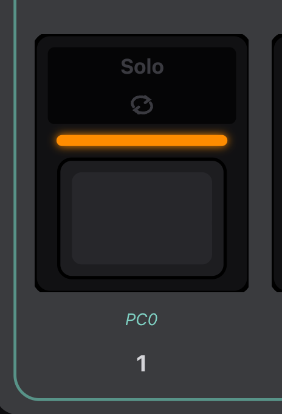
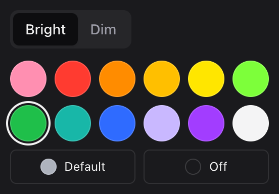

# Lights and Colours

Every switch on the Pacer has a colour bar. Above it, the front-row switches
have two legends (a text one and an icon one), and the back-row switches have
one printed legend. All of them are full-colour lights. For each step, you pick
which light it uses and what colours it shows.

## One Light at a Time

A switch shows the colours of one step, the one that will fire next. In *All
at once* mode that's always step 1, so give step 1 the colours you want to see.
The other steps' colours never show. In *Sequence* mode the light moves through
the steps as you press.

Each step's card in the editor tells you whether its colours will show, and
the one that's lighting the switch has a **lights the switch** badge.

## Two Colours, Picked by State

Each step has two colours, and which one you see depends on what the step last
did:

| Step type | First colour | Second colour |
|---|---|---|
| CC Toggle, CC Trigger | while the CC holds the step's first value | otherwise |
| Note, Note Toggle | while the note is on | otherwise |
| Program + Bank | while this program is the current one on its channel | otherwise |
| Preset Select to one of your presets | always | (not used) |
| Preset Select to Track or Transport | while that DAW preset is active, in light blue | |
| Preset Inc/Dec | the light stays dark | |
| anything else | while you hold the switch | otherwise |

So a CC Toggle with green and red is green while its effect is on and red
while it's off. It stays that way when you change preset and come back,
because the Pacer remembers the CC's value.

Holding a switch down shows its first colour, whatever the table says, and
letting go puts it back. That's how the factory SEQNC preset (D6) lights up on
each press even though its lights rest dim. Preset Select and Inc/Dec keep their
own lights while held.

## Default, Off and the Palette

There are twelve hues, each in a bright and a dim version. A common choice is
the same hue twice, bright for on and dim for off.

**Default** uses the step type's own colour: orange for programs, blue for
CCs, green for notes, red for preset changes, and so on. It's bright when on
and dim when off, and most factory presets use it. **Off** keeps the light
dark.

## Which Light

The **Light** setting picks the bar or one of the legends. You're only offered
the lights that switch has. A legend lit by a step takes the step's colour,
whatever colour it's printed in.

The firmware also lights legends on its own to show what a switch is assigned
to: the arrows on C and D while they step through presets, *Track* on A while A
selects the Track preset, and so on.

## Lit by Incoming MIDI

If you set **Lit by** to *Incoming MIDI*, a CC step's light belongs to whatever
sends that CC back to the Pacer over USB, usually a DAW. Pressing the switch no
longer changes the light. This only works over USB (the Pacer has no MIDI In
jack), and only for CC steps. See
[Program mode](../reference/program-mode.md#lit-by-incoming-midi).

The exact rules the Pacer follows are in
[Programming the Pacer › Lights](../reference/programming-the-pacer.md#lights).
