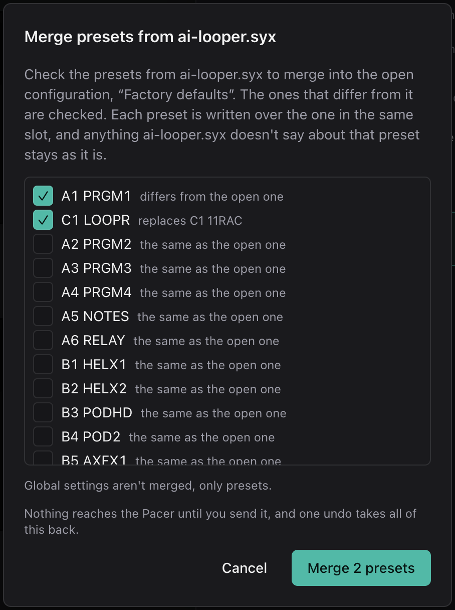

# Devices and Files

Your work lives in two places, and the app keeps them apart.

This browser holds snapshots of configurations: ones you pulled from a Pacer,
imported from files, or saved from your edits. Nothing in a snapshot reaches
the Pacer until you send it.

The Pacer holds whatever it was last sent. The app reads it with **Pull** and
writes it with **Send**, and it never does either on its own.

Pulling and sending both need MIDI, so your browser has to support Web MIDI
(on a computer, [Google Chrome](https://www.google.com/chrome/) does). Everything else, including the
simulator, programming, the map, and importing and exporting files, works
without MIDI.

## The Device Drawer

Click the configuration's name in the header, or the device status next to it,
to open the drawer:

| | Part | What it does |
|---|---|---|
| 1 | Pull from Pacer | Reads everything on the Pacer into a new snapshot and opens it. Nothing on the device changes. |
| 2 | Import config… | Opens a `.syx` file as a new snapshot. |
| 3 | Pick presets from a file… | Merges the presets you choose from a `.syx` file into the configuration that's open, and keeps the rest of it. |
| 4 | Pacer ports | The Pacer's MIDI input and output. The app picks any port with "Pacer" in its name; if yours is named differently, choose them by hand. |
| 5 | Firmware | What the Pacer says when asked who it is. The app asks automatically whenever its ports show up. |
| 6 | Factory defaults | The Pacer's factory configuration, built into the app. It's always there and can't be changed, so edits to it are saved as a new snapshot. You can export it like any other. |
| 7 | The open configuration | Highlighted. Click any other row to open that configuration instead. The pencil beside a snapshot's name renames it (or press F2 on the name). |
| 8 | Pick presets from this…, Export, Delete | **Pick presets from this…** merges presets you choose from that configuration into the open one (every row but the open one has it). **Export** downloads it as a `.syx` file. The trash can deletes a snapshot, and asks you to click again to confirm. The factory defaults can't be deleted or renamed. |
| 9 | Download all (.zip), Load a .zip… | Every saved snapshot in one zip file, and back again. See [Backing up every snapshot](#backing-up-every-snapshot). |

Until you've granted MIDI access, the drawer shows a **Connect MIDI** button
where the ports would be.

### Pulling from the Pacer

**Pull from Pacer** asks the Pacer for a full dump: all 24 presets, its working
copy and its global settings, which comes to about 4,800 SysEx messages. A
progress bar counts them in, and **Cancel** stops it. When the Pacer goes
quiet, the dump is saved as a snapshot named after the time, and opened.

If the Pacer doesn't answer, the drawer says so. Check that it's on, that the
ports are right, and that MIDI is allowed for this site.

The firmware line only shows the Pacer's major and minor version (`0101` means
firmware 1.01), because that's all the Pacer reports. A dump doesn't carry a
version at all.

### Importing and Exporting Files

**Import config…** takes any full Pacer dump, whether it was saved by this app, by
Nektar's editor, by a MIDI utility, or written by hand or by an AI (see
[Working with an AI](../guide/working-with-ai.md)). It becomes a new snapshot,
and the original file isn't touched.

**Export** on a snapshot's row downloads it as a `.syx` file. Those are the
same bytes the Pacer would send in a dump, so any SysEx tool can send it back
to the Pacer. To export your edits, save them first and then export the
snapshot.

### Merging Presets into the Open Configuration

A `.syx` file doesn't have to be a whole dump. It's a list of messages, and
each one sets a few fields of one preset, so a file can hold two presets, or
just one switch of one preset. That's often what an AI gives you when you ask
it to write a preset.

**Pick presets from a file…** merges a file's presets into the configuration
you have open, where **Import config…** would open the file in its place. Pick
a file and it lists the presets in it:

The presets that differ from what you have open come first, already checked.
If an AI changed two presets in a whole dump, those two are the ones checked. Uncheck any you don't want and click **Merge**.

Each preset is written over the one in the same slot. If the file only sets
part of a preset, the rest of that preset stays as it was, which is exactly
what the Pacer would do if you sent it the file. Global settings in the file
are left out.

A preset you've edited since opening the configuration is marked. The file may
have an older version of it, so uncheck it if you'd rather keep your edit.

Merging presets is an edit like any other. You can undo it, it's unsaved
until you save, and the presets it changed are the ones **Send to Pacer…**
offers to write.

If you pick a file with only some presets in it for **Import config…**, you
get the same list, since a file like that can't stand as a configuration by
itself.

**Pick presets from this…** on a row of the list does the same with a saved
configuration instead of a file, so you can take a preset or two from another
snapshot, or put back a factory preset, without opening it.

If a file isn't a Pacer dump, or it's damaged, the import is refused and you're
told why. The app checks every message's framing and checksum. What a valid
dump contains is described in [Programming the Pacer](programming-the-pacer.md).

### Snapshots

A snapshot is the configuration's raw SysEx bytes, plus a name, where it came
from, when, and how many presets it holds. The second line of each row shows
all of that.

Pulled and imported snapshots are never changed by editing. Your edits only
become a snapshot when you save.

Snapshots live in this browser's local storage, which holds about 25 full
dumps. Clearing the browser's site data deletes them, so export any you want to
keep. Whatever configuration you had open is reopened when you come back.

If you have unsaved edits, opening another configuration, importing or pulling
will first ask whether you want to throw them away.

### Backing Up Every Snapshot

**Download all (.zip)**, above the list, puts every saved snapshot in one zip
file. Each one is a plain `.syx` inside it, the same bytes **Export** would
give you, so any SysEx tool can use them. A small `library.json` beside them
remembers each snapshot's name, where it came from and when. The factory
defaults aren't included, since they're built in.

**Load a .zip…** adds the snapshots in a zip to your list. Nothing you already
have changes unless you say so. Where a name in the zip is already taken, its
row has a checkbox: leave it unchecked to keep the one you have and skip the
zip's, or check it to replace yours with the zip's. With several taken names,
**Replace all of them** and **Keep all the saved ones** set every box at
once. A snapshot that's identical to the one you have is skipped without
asking, and one that can't be read is listed with the reason.

Replacing the configuration you have open reopens it from the zip, so if you
have unsaved edits you're asked first.

This is also how you move your snapshots to another browser or computer, or
into the app once you've installed it (see
[Browsers and Installing](../guide/browsers-and-installing.md)). A zip of
`.syx` files made some other way loads too, with each snapshot named after its
file.

## Saving

**Save…** in the context bar (in Program mode and on the preset map) opens
this:

**Save as new snapshot** keeps your edits under the name you give, and leaves
the snapshot you started from as it was. The default name is the old one with
"(edited)" on the end. **Save over "…"** replaces the open snapshot with your
edits. It isn't offered for the factory defaults.

Saving clears the **unsaved** badge. It doesn't send anything to the Pacer.

## Sending to the Pacer

**Send to Pacer…** in the context bar writes presets to the Pacer:

First pick which presets to send:

| Choice | Sends |
|---|---|
| Changed (the default) | The presets you've changed since the configuration was opened, or since they were last sent. |
| This preset | Only the preset you're on. |
| All | All 24. |

The dialog lists exactly which presets will be overwritten. Then
**Overwrite N presets on the Pacer** writes them. The Pacer has no undo, so pull
a copy first if you want to keep what's on it. **Read back afterwards to
verify**, which is on by default, pulls the Pacer's configuration again and
compares the presets you sent. That takes about eight seconds, and the result
tells you whether they match. Global settings are never sent, only presets.

The loaded preset gets updated too. The Pacer actually runs a working copy of
whichever preset it has loaded, and writing to a preset's slot doesn't change
that copy. So the app asks the Pacer which preset it has loaded, and if it's
one you're sending, the app updates the working copy as well, and the new
version is live right away. If the Pacer doesn't say which preset it has
loaded, the result asks you to select the preset again on the Pacer.

While a send is running, nothing else goes to the Pacer, including for about a
second afterwards while it stores what it was sent. (It turns out that asking
it for anything too soon after a write can corrupt the preset you just wrote.)
If your [simulated MIDI output](the-window.md#in-simulate) is the Pacer itself,
presses in the simulator are dropped during that time rather than sent.
**Cancel** stops a send part way through. Any presets already written stay
written, and the result tells you which ones.

**Send to Pacer…** stays grayed out until MIDI is allowed and the
Pacer's output port is chosen.

The [preset chooser](the-faceplate.md#the-preset-chooser) marks each preset the
Pacer hasn't been sent with a hollow dot, so you can see what *Changed* will
send before you open the dialog.
