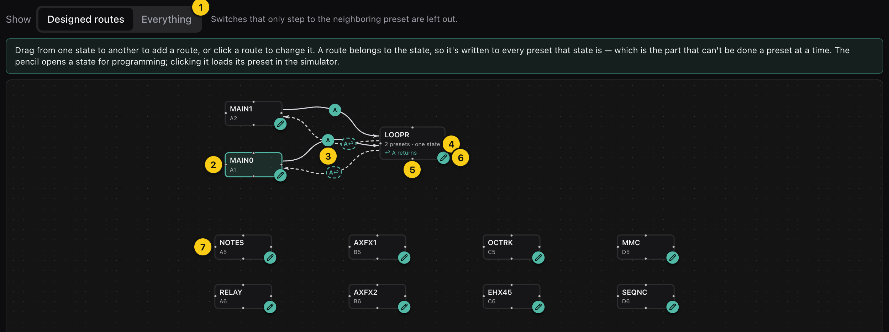
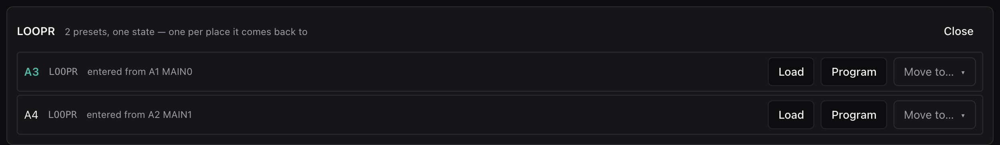
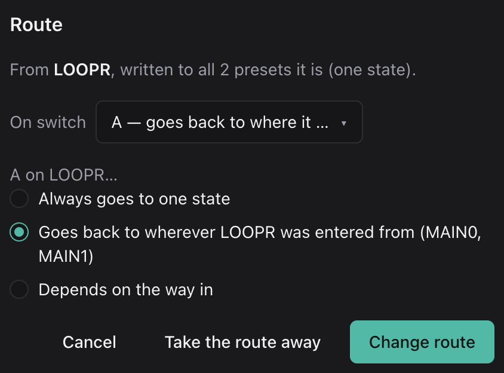
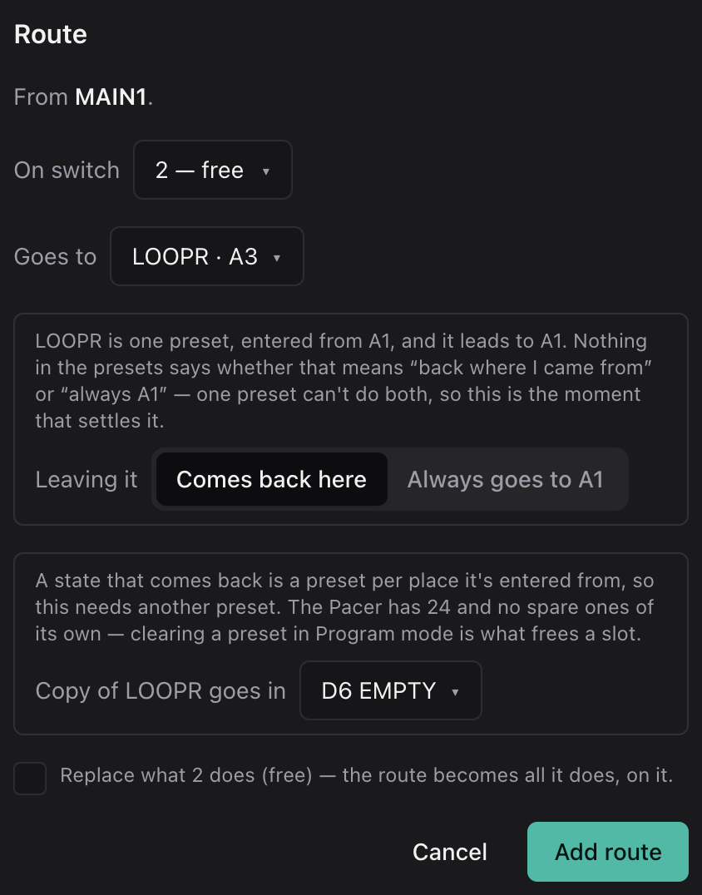
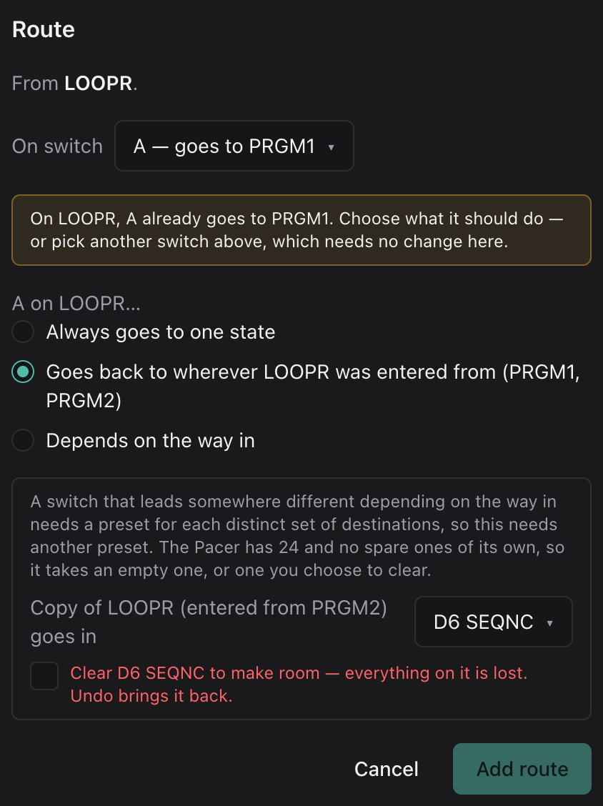

# The Preset Map

The preset map draws your configuration the way you designed it: as places,
and the switches that move between them. This is where you'll notice that four
presets are really two main sounds and one looper, and it's where you change
how they connect.

If the idea is new to you, read [Why a state machine](../why-a-state-machine.md)
first. The [tutorials](../tutorials/README.md) build one step by step.

| | Part | What it is |
|---|---|---|
| 1 | Show | *Designed routes* leaves out plain next/previous stepping, which almost every preset has and which tells you nothing about your design. *Everything* draws it too, faintly. |
| 2 | A state | A place your Pacer can be. It shows its name, with the preset it lives in underneath. The state you're on is highlighted. |
| 3 | A route | A switch that moves you from one state to another, labeled with the switch's marking (`A`, `C`, `3`). Click it to change it. A dashed route is one of several places its switch can go, depending on how you got in, and `A↩` marks a way back. |
| 4 | Several presets, one state | Presets that behave identically apart from where their switches lead are drawn as a single state. Hover to see which presets. |
| 5 | ↩ returns | The state has a switch that goes back to wherever you entered it from, switch A in this case, drawn as the dashed routes back. The Pacer can't do that on its own. It takes one preset per way in, which is why LOOPR is two presets. Click it to change where A goes. A switch that goes back from some ways in and somewhere fixed from others says *by way in* instead. |
| 6 | Pencil | Opens the state in [Program mode](program-mode.md), on the preset you're on if it's one of them. Double-clicking the state does the same. |
| 7 | A preset nothing routes to | Every preset is a state, even if no switch jumps to it. The factory presets only step between neighbors, so with *Designed routes* they stand alone. |

The context bar above the map has the preset chooser, plus the same undo, Save
and Send controls as [Program mode](program-mode.md), since changing a route is
an edit like any other.

## What Makes a State

Two presets are the same state when they do exactly the same thing on every
switch (the same messages, lights, control modes and load-time MIDI) and only
differ in where their jumps lead. Names don't count. Two copies can have
different names and still be one state, and a state only gets a name if every
copy shares it.

The map uses this rule both when it reads your presets and when you edit them.
When you change a state in
[Program mode](program-mode.md#editing-a-state-several-presets-at-once), the
change goes to every copy, so they stay one state.

Returns are worked out from the copies. A state's switch counts as a return
when the state has more than one copy and each copy leads back to the preset
that enters it. With only one copy there's no telling a return apart from a
plain jump, so the map reads it as a plain jump. It makes no difference until
there's a second way in, and that's when the dialog
[asks](#where-a-switch-leads).

A switch can also go back from some ways in and somewhere fixed from others.
Say a looper goes back to MAIN0 or MAIN1 when you came from one of them, but
to MAIN0 from anywhere else. Those ways in share a copy, so that's three ways
in and two presets. The map reads that too, and shows it as *A by way in*.
Returns can nest as well: a tuner reached from the looper that goes back to
whichever looper copy you came from. Each level multiplies the copies, so
it's rarely worth it on a 24-preset device, but if you build one by hand, the
map draws it instead of giving up.

Stepping doesn't count as a way in. Next and previous name a direction rather
than a preset, so they never count toward entering a state, and they're left
off the map unless you choose *Everything*.

## Clicking Around

| Do this | And you get |
|---|---|
| Click a state | Its preset loads in the simulator, and its presets are listed [below the map](#a-states-presets). |
| Double-click a state, or click its pencil | It opens in Program mode. |
| Click a route (the line or its badge) | The [route dialog](#the-route-dialog) for it. The preset it leaves from is loaded, so the faceplate is the one you're changing. |
| Drag from one state to another | A new route between them. Drag from one of the small dots on a state's edge and drop on the other state's. |

## A State's Presets

Clicking a state lists the presets behind it:

Each row shows the preset's slot and name (the one you're on is highlighted),
and which presets jump to it. For a state that returns, that's where each
copy goes back to.

**Load** loads the preset in the simulator, and **Program** opens it in
Program mode. **Move to…** moves it to another slot, and everything that
jumped to it follows. Empty presets are offered first. Presets no route leads
to or from come after, under **In use — would be cleared**, and choosing one
asks before it clears it, because moving onto a preset deletes what was there.
This is handy for tidying a state's copies into one bank, say.

If a move would change what the configuration does, rather than just where a
preset sits, it's refused and the reason shows up here.

## The Route Dialog

Clicking a route opens it:

- **From** is the state the route leaves from. If that's several presets, the
  route is written to all of them.
- **On switch** is which switch carries it. Each switch says what it does now:
  *free*, *sends 2 messages*, *goes to LOOPR*, *goes back to where it was
  entered from*, *selects the Track preset*, and so on. Pick a different
  switch to move the route there, and the switch it leaves goes back to doing
  nothing.
- **Goes to** is the state it leads to. When the state has more than one way
  in, this becomes the [choice below](#where-a-switch-leads).
- **Replace what the switch does** appears when you pick a switch that's busy.
  If you check it, the switch is emptied on every preset of the state, and the
  route becomes the only thing it does. If you don't, the route is added as
  one more step, as long as the switch has a free one.
- **Take the route away** stops the switch from jumping. Its other steps stay.
- **Change route** (or **Add route**) writes it, and **Cancel** changes
  nothing.

Dragging between two states opens the same dialog, with *Goes to* filled in and
*On switch* set to the first free switch.

### Where a Switch Leads

A copy of a state is only ever needed for one reason: a switch that has to lead
somewhere different depending on how you got in. So drawing a route *into* a
state never asks anything and never costs a preset, however many ways in it
ends up with. The question comes up on the way out. Once a state has more than
one way in, its switches can do one of three things:

| Choice | Means | Costs |
|---|---|---|
| Always goes to one state | The switch leads to the same place whichever way you came in. | Nothing. |
| Goes back to wherever *LOOPR* was entered from | Each way in gets back to where it came from. | A copy per way in. |
| Depends on the way in | A row per way in, each going back or to a state you pick. | A copy per different set of destinations. Ways in that go to the same places share one. |

If the switch you pick already leads somewhere else, the dialog says so and
waits for you to choose. Picking a different switch is often the cheaper
answer: one switch for each way back needs no copies at all.

Routing into a state whose switches already depend on the way in is the other
case that asks. The new way in needs to say where those switches lead from
it. They default to going back, which costs a copy, and you can point them at
a state instead.

### When a Route Costs a Preset

The dialog works out the cost before it writes anything. Each new copy gets a
picker, **Copy of LOOPR for MAIN1** (the copy LOOPR needs for when it's entered from MAIN1), which offers empty
presets first. If there aren't any, which is how a Pacer starts out, it lists
the presets no route leads to or from under **In use — would be cleared**.
Choose one of those and the dialog asks you to check a box naming the preset
before it'll go ahead. The preset is cleared as part of the same edit, so one
undo brings it back. A preset that's part of a route is never offered. To give
one of those up, [clear it](program-mode.md#clear-preset) in Program mode.

It goes the other way too. A change that means a state needs fewer copies, like
switching *Goes back* to *Always goes to one state*, frees the copies nobody
reaches any more. The dialog lists them as *Frees D6*, and they're cleared and
named `EMPTY`.

The Pacer has 24 presets and no spare ones, so a design that returns from lots
of places can fill them up quickly. See [Slot budget](#slot-budget).

### When a Route Is Refused

The dialog won't write a route that the map couldn't read back the same way.
The message tells you why. These are the common ones:

| Message | Why | What to do |
|---|---|---|
| *A route can't lead to the state it leaves from.* | That's a reload. | Use Preset Select → Current in Program mode. |
| *Step 1 on that switch already jumps somewhere…* | A press only takes the first jump. | Check *Replace*, or pick another switch. |
| *Every step on A is in use…* | There's nowhere to put the jump. | Check *Replace*, or pick another switch. |
| *…already behaves like "LOOPR" apart from where it leads…* | Another preset is identical to the state's copies, so after the edit it would be read as one of them. | Give the state something of its own, or clear that preset. |
| *LOOPR's switch A would come back meaning…* | The presets this edit would write wouldn't read back as the design you asked for. | Usually another switch, or a different choice, does it. |

[Troubleshooting](troubleshooting.md) covers the rest.

## Slot Budget

Every state that returns costs one preset per way in. If you have twelve main
presets that each lead into a looper, that's twelve looper copies, and all 24
slots are used up. The map keeps track of this as you go and asks for a slot
each time, so you can't end up designing something the Pacer can't hold.

If you need more room, you can [clear a preset](program-mode.md#clear-preset)
you don't use, which turns it into an empty slot that routes will offer first.
Or, where you don't actually need to go back to the origin, use **Always
goes to one state**, or give each way back its own switch, which costs
nothing.

## Notes the Map Can't Draw

Sometimes there's something on the device that can't be expressed as states
and routes, such as two copies that should be one but lead somewhere
inconsistent. The map draws it as it is, and lists it above the map under
*1 thing on this device the machine can't express…*. That isn't an error. It
just can't be drawn as a design. Your own edits can't add new ones, because an
edit that would is refused.
