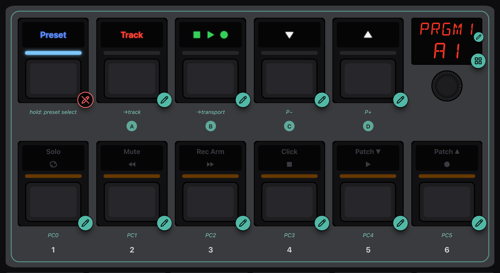
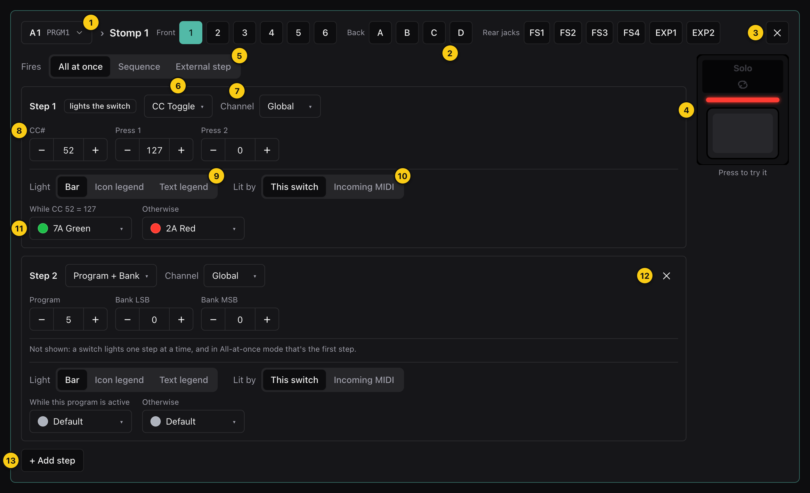
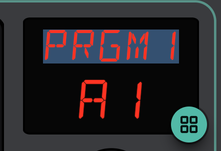
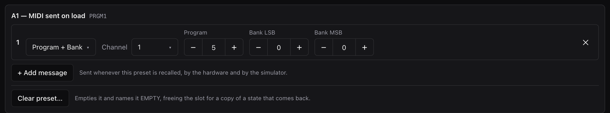
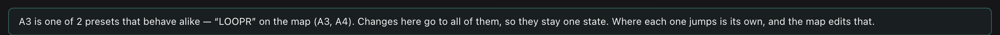

# Program mode

Program mode is where you change what your presets do. Everything you change
is live: the faceplate, the simulator and the preset map all run the edited
configuration straight away, so you can press what you just programmed and
hear it on your gear before the Pacer ever sees it.

Nothing reaches the Pacer until you [send it](devices-and-files.md#sending-to-the-pacer).

## The faceplate in Program mode

- **Every programmable control carries a pencil.** Tap the control (or its
  pencil) to open it in the [switch editor](#the-switch-editor). Tapping
  doesn't fire anything in Program mode.
- **[Preset] carries a struck-out pencil** and does nothing: it belongs to
  the firmware and can't be programmed.
- **The display has two badges.** The small pencil beside the name
  [renames the preset](#renaming-a-preset); the one in the corner opens the
  [preset chooser](the-faceplate.md#the-preset-chooser).
- **The rear jacks** (footswitches 1–4, expression pedals 1–2) have pencils
  too, and open in the same editor.

## The switch editor

Opening a control replaces the faceplate with its editor:

| | Part | What it does |
|---|---|---|
| 1 | **Preset** | The preset you're editing, as a breadcrumb: `A1 PRGM1 › Stomp 1`. Click it to switch preset without leaving the editor. |
| 2 | **Switch picker** | Every programmable control — front row 1–6, back row A–D, rear jacks. Pick another to edit it on the same preset. |
| 3 | **Close** | Back to the faceplate. Your browser's Back button does the same. |
| 4 | **Live control** | The control you're editing, working: press it and it fires, lights and sends exactly as in Simulate. "Press to try it." |
| 5 | **Fires** | The control mode: what one press does with the steps (see [below](#control-modes)). |
| 6 | **Step type** | What this step sends or does. |
| 7 | **Channel** | The MIDI channel it sends on. *Global* follows the configuration's own channel. Only for types that send channel messages. |
| 8 | **Data** | The type's own values, labelled for that type: CC number and values, program and bank, note and velocity… |
| 9 | **Light** | Which of the switch's lights this step colours. |
| 10 | **Lit by** | Whether the light follows the switch or MIDI coming in (see [below](#lit-by-incoming-midi)). |
| 11 | **Colours** | The two colours the light can show, labelled by *when* each one shows. |
| 12 | **Remove step** | Turns the step off. Steps 2–6 only; step 1 always exists. |
| 13 | **+ Add step** | Turns on the next free step. A control has six; the button is disabled once all are in use. |

Step 2 in the picture shows a note in place of its colours: *Not shown: a
switch lights one step at a time, and in All-at-once mode that's the first
step.* Each card says whether its colours will ever be seen, and when. Step 1
carries the badge **lights the switch**.

### Control modes

| Fires | One press… |
|---|---|
| **All at once** | Fires every active step, in order. This is how one press can send a Program Change *and* jump to another preset. The usual choice. |
| **Sequence** | Fires the next active step, wrapping after the last. Inactive steps are skipped; a step whose type is Off still takes its turn and sends nothing. |
| **External step** | Fires the step another switch has chosen with Step Select or Step Inc/Dec. |

More detail, and what the hardware does in each, is in
[Programming the Pacer › Control modes](programming-the-pacer.md#control-modes-what-a-press-fires).

### Step types

The type picker groups them by what they do.

**Send MIDI**

| Type | Data | A press… |
|---|---|---|
| Program + Bank | Program, Bank LSB, Bank MSB | Sends a bank select (if set) and a program change. |
| Program Step | Start, End | Sends the next program in a range, one per press. |
| CC Trigger | CC#, Press, Release | Sends *Press* on press and *Release* on release. |
| CC Toggle | CC#, Press 1, Press 2 | Sends *Press 1*, or *Press 2* if the controller already holds *Press 1*. |
| CC Step | CC#, Start, End | Steps a controller through a range. |
| Note | Note, Velocity | Sounds the note while held. |
| Note Toggle | Note, Velocity | Starts the note; the next press stops it. |
| NRPN Coarse / Fine | Value, NRPN LSB, NRPN MSB | Sends an NRPN value. |
| MMC | Device, Command | Sends a MIDI Machine Control command (stop, play, record…). It's SysEx, so it needs SysEx permission to reach your gear. |

**Pacer actions** — these act on the Pacer itself, and send nothing on the
MIDI wire:

| Type | Data | A press… |
|---|---|---|
| Preset Select | **Jump to**: a user preset A1–D6, or the firmware's Track / Transport | Loads that preset. |
| Preset Inc/Dec | **Direction**: next or previous | Steps to the neighbouring preset, wrapping D6 → A1. |
| Relay | Mode, Relay | Switches one of the four relay outputs. |
| Step Select / Step Inc/Dec | Data 1–3 | Chooses which step another switch in External step mode fires. |

**Nothing** — *Off* gives the step nothing to do.

Expression pedals have their own list: MIDI CC, Pitch Bend, Channel
Aftertouch and NRPN, each swept between a *Min* and *Max* as the pedal moves.

The byte layout of every type is in
[Programming the Pacer › Step message types](programming-the-pacer.md#step-message-types).

### Lights and colours

A switch shows one step's colours at a time — the step that will fire next.
In All-at-once mode that's always step 1; in Sequence mode it follows the
sequence.

**Light** chooses which light that step uses. The options are only the lights
that switch really has: the front row has a *Bar*, an *Icon legend* and a
*Text legend*; the back row has a *Bar* and its printed legend.

The two colours are labelled by what makes them show, because it depends on
the type:

| Type | First colour shows… | Second colour shows… |
|---|---|---|
| CC Toggle, CC Trigger | While CC *n* holds *Press 1* (or *Press*) | Otherwise |
| Note, Note Toggle | While the note is on | Otherwise |
| Program + Bank | While this program is active on the channel | Otherwise |
| Preset Select (to a user preset) | Always — the second is unused | — |
| Preset Inc/Dec | Never: the light stays dark | — |
| Anything else | While the switch is held ("On color") | Otherwise ("Off color") |

"Holds" means the last value the Pacer sent on that controller, from any
switch on any preset. Two switches toggling the same CC share their state,
and their lights agree.

Click a colour to open the picker:

- **Bright / Dim** — each of the twelve hues comes at two brightnesses.
- **Default** — the type's own colour: orange for programs, blue for CCs,
  green for notes, red for preset changes and so on, bright when on and dim
  when off.
- **Off** — the light stays dark.

The full colour table is in
[Programming the Pacer › Colour codes](programming-the-pacer.md#colour-codes).

### Lit by incoming MIDI

**Lit by: Incoming MIDI** hands a CC step's light to your DAW. The light then
follows that CC *arriving* over USB, and pressing the switch no longer
changes it (the step still sends). It's the Pacer's own "MIDI LED feedback"
setting.

- It only works on CC steps. On anything else it has no effect, and the
  editor says so.
- The Pacer has no MIDI In jack, so the CC has to come back over USB, from
  something that echoes it.
- The app has no MIDI input, so the simulator shows what the Pacer shows
  before anything answers: the second colour.

### Edits that touch more than one place

Some steps are shared between switches whether you meant it or not:

- **Two switches on the same CC share a value.** Toggling one changes what
  the other sends next, and both lights follow.
- **A Preset Select's target** is the one thing that's edited per preset even
  when you're [editing a state](#editing-a-state-several-presets-at-once).
  It's where that copy leads, and the copies have to differ there.

## Renaming a preset

Tap the small pencil beside the name on the display. The name line opens for
typing, with the old name selected:

- **Enter** or clicking away keeps it; **Escape** puts the old name back.
- Up to **five characters** — that's what the display shows. A longer name,
  or a character the Pacer can't store, is shown in red and can't be kept.
- Names are stored in capitals, as the Pacer has them.
- Characters outside A–Z, 0–9, space and `-` are allowed, with a warning:
  the Pacer can store them, but it may not draw them.

## The preset's own settings

Below the faceplate, Program mode shows what belongs to the preset rather
than to any switch:

### MIDI sent on load

Up to sixteen messages the preset sends whenever it's recalled — by preset
select, by a switch jumping to it, or by stepping. Use it to put your rig in
the right state for the preset: a program change for the amp, a CC to set a
level.

- **+ Add message** adds one; **✕** removes it.
- Each has a type (Program + Bank, CC, Note, NRPN, MMC, or Relay), a channel
  and its data, as for a step. Note that a preset's CC is *controller, value*: it has
  one value, where a switch's CC Toggle has two.
- The simulator sends them too, when you load the preset.

### Clear preset

**Clear preset…** empties the preset: every switch is set to Off, its
load-time MIDI is removed, and it's named `EMPTY`. A confirmation says what
will go, and warns you if any preset still jumps here.

An empty preset is a **spare slot**. When the [preset map](preset-map.md)
needs a new preset for a state that comes back — one copy per place it's
entered from — it offers the spare slots first. A preset only counts as
spare if it does nothing but step to its neighbours.

Like every edit, clearing is undoable until you send.

## Editing a state: several presets at once

On the preset map, presets that behave alike are drawn as one **state**. The
usual example is a looper preset with one copy per place it's entered from.
The copies have to stay identical apart from where they lead back to, or
they stop being one state.

So when the preset you're on is one of several, Program mode edits them all
together, and tells you so in three places.

**The context bar** offers a choice:

| Changes | Your edits go to… |
|---|---|
| **All N presets** (the default) | Every preset in the state. They stay one state. |
| ***A3* only** | This preset alone. It stops behaving like the others and leaves the state. |

Hover the choices to see which presets they mean.

**The display** shows the number of presets instead of the preset number:

**The preset panel** says which presets they are:

Everything you edit follows the choice: steps, colours, control modes,
the name, load-time MIDI. **Clear preset** is the exception that's obvious —
it always clears just the one in front of you. The one that isn't is **where a
Preset Select leads**:
that's always edited on the preset in front of you, because it's what tells
the copies apart. Routes between states are better changed on the
[preset map](preset-map.md), which keeps every copy's way back in order.

## Undo, redo and unsaved changes

- **Undo / Redo**, ⌘Z / ⇧⌘Z (Ctrl on Windows and Linux), cover every edit:
  steps, names, preset MIDI, clearing, and every change made on the preset
  map.
- **unsaved** appears once something has changed since the configuration was
  opened or saved. **Save…** keeps it in this browser
  (see [Devices and files](devices-and-files.md#saving)).
- In the [preset chooser](the-faceplate.md#the-preset-chooser), a filled dot
  marks each preset you've edited and a hollow one each preset the Pacer
  hasn't been sent.
