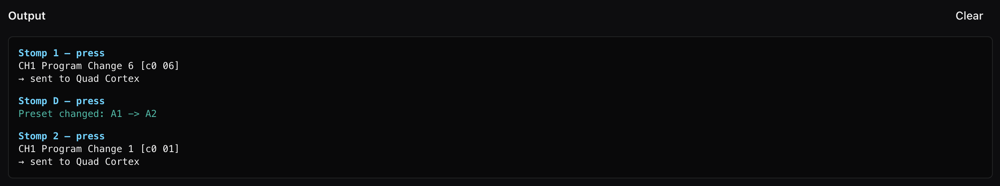

# Simulate Mode

Simulate mode turns the on-screen Pacer into a working one. Press its switches
and it does what the hardware would do with the configuration you have open.
It lights up, changes preset, and sends MIDI to the log and, if you want, to
your real gear.

That last part is what makes it useful. Pick your guitar processor, synth or
DAW as the simulated MIDI output, and the on-screen Pacer drives it the same
way the real one would. You can change a preset in
[Program mode](program-mode.md), switch over to Simulate, and hear the result
on your rig, without sending anything to the Pacer and without having one
plugged in at all. You only send the programming to the Pacer once you're happy
with it. See [The simulator](../guide/the-simulator.md) for more on working
this way.

## What's on Screen

The context bar holds the simulated MIDI output and the **Reset MIDI state**
button (see [The window › In Simulate](the-window.md#in-simulate)). Below it
are the [faceplate](the-faceplate.md), the rear jacks with the external
footswitches and expression pedals, and the output log.

## The Output Log

Each press gets an entry, with the newest at the top:

| Line | Meaning |
|---|---|
| Stomp 1 — press (blue) | What you did: which control, and whether it was a press or a release. |
| `CH1 Program Change 6 [c0 06]` | A MIDI message the press sent, decoded, with its bytes. |
| Preset changed: A1 → A2 (teal) | The press changed preset. The new preset's load-time MIDI follows it. |
| `→ sent to Quad Cortex` | The messages above went out to your simulated MIDI output. You won't see this line if the output is *Don't send*. |
| *(warning)* … (amber) | Something didn't go the way the configuration asked. Either a message couldn't be sent, or the press is one the Pacer handles in a way worth knowing about (two jumps on one press, for example, where only the first counts). |
| `(not sent) the Pacer is being written to…` | You've chosen the Pacer's own port as the output, and a send is in progress. Presses are dropped rather than queued, so they can't corrupt the write. |

**Clear** empties the log.

The firmware's own presets show up here too: entering preset select, Track or
Transport, and the DAW commands those presets send (by name; see
[What isn't simulated](#what-isnt-simulated)).

## What the Simulator Remembers

Like the Pacer, the simulator remembers the last value it sent on every
controller, note and program, per channel. That memory decides two things.
It decides what a toggle sends next: a CC Toggle sends its second value if the
controller already holds its first, no matter which switch sent it. And it
decides what colour each switch shows, bright when "on" and dim when "off".

The memory survives changing preset, just as it does on the hardware, so a
program you selected on A1 is still lit when you come back to A1.
**Reset MIDI state** forgets all of it, as if the Pacer had just been switched
on. Opening another configuration does the same.

The simulator also remembers where each expression pedal sits, since a real
pedal stays wherever your foot left it.

## Loading Presets

Every way of reaching a preset counts as recalling it, and fires the preset's
[MIDI sent on load](program-mode.md#midi-sent-on-load) before anything else
happens. That includes a switch that jumps or steps there, the firmware's
preset select (hold [Preset], then pick a bank and a number), the
[preset chooser](the-faceplate.md#the-preset-chooser), and clicking a preset on
the [map](preset-map.md).

Opening a configuration doesn't count as a recall, so nothing is sent when you
load a file.

## What's Simulated

- Every step type, on press and release, in All at once and Sequence modes.
  (External step mode is listed [below](#what-isnt-simulated).)
- The lights: which light, which colour, and bright or dim, following the same
  rules the hardware does (see
  [Programming the Pacer › Lights](programming-the-pacer.md#lights)).
- Preset Select and Preset Inc/Dec, including wrapping from D6 back to A1.
- The firmware's preset select, with its hold timing, and its Track and
  Transport presets.
- Each preset's load-time MIDI.
- Expression pedals, swept between their minimum and maximum, with pitch bend
  spread over 14 bits the way the hardware does it.
- Relay actions, which show up in the log.

## What Isn't Simulated

- DAW commands from the Track and Transport presets are logged by name but not
  sent, because we don't know the bytes of Nektar's DAW integration.
- Incoming MIDI. The app has no MIDI input, so a light set to be
  [lit by incoming MIDI](program-mode.md#lit-by-incoming-midi) shows what the
  Pacer shows before anything answers.
- External step select, where one switch picks which step another switch
  fires. The simulator doesn't follow that across switches.
- The Pacer's setup menus and global settings. The encoder doesn't do
  anything.
