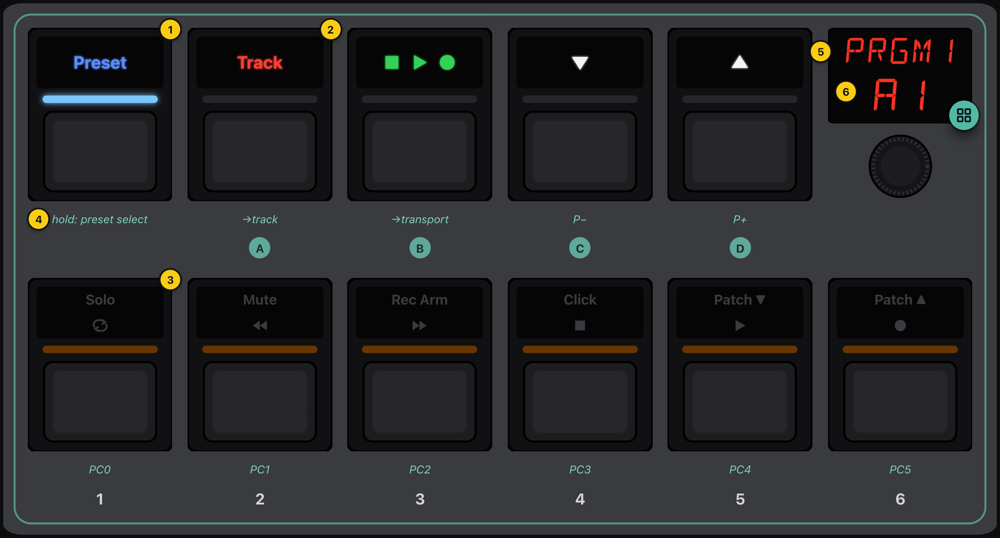
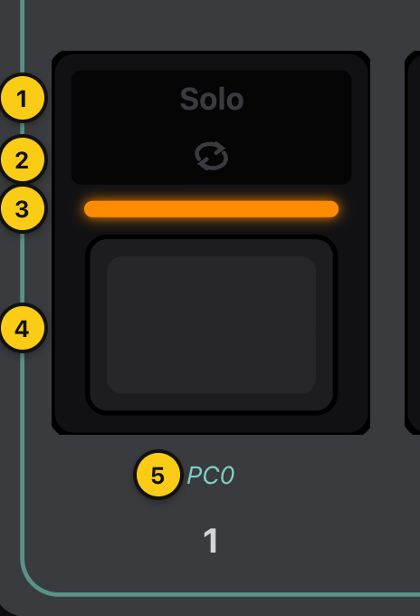
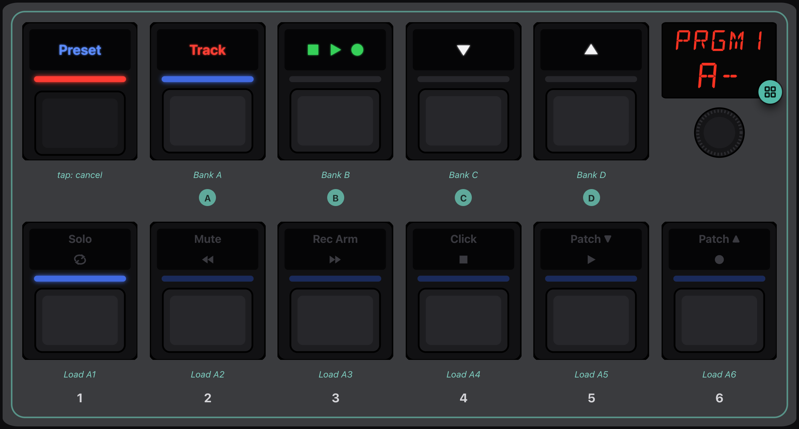
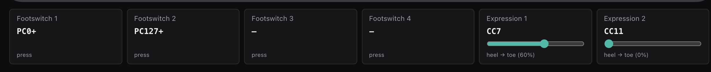
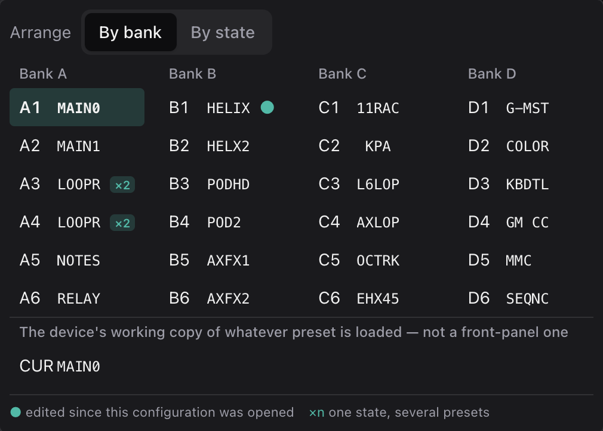
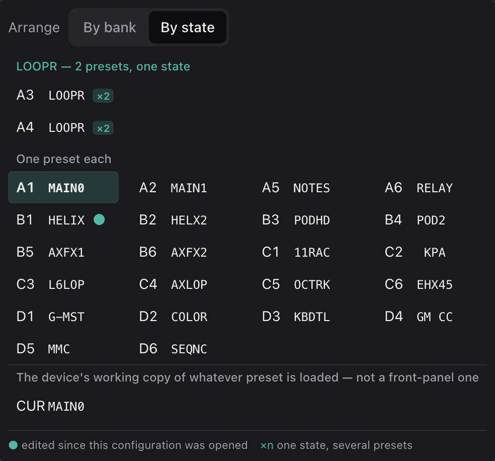

# The faceplate

The faceplate is the on-screen Pacer. In Simulate mode it behaves like the real
one: press a switch and it lights, changes preset, and sends whatever MIDI the
real Pacer would. In Program mode, tapping a control opens it for programming
instead (see [Program mode](program-mode.md)).

| | Part | What it does |
|---|---|---|
| 1 | [Preset] | Tap it, or hold it for the firmware's preset select (see [below](#preset-select)). You can't program it. |
| 2 | Stompswitches A–D | The back row. You program them like any other switch, and in preset select they choose a bank. |
| 3 | Stompswitches 1–6 | The front row. Programmable, and in preset select they load a preset from the chosen bank. |
| 4 | Hint | The app's note of what a press will do on this preset, like `PC0`, `→track` or `P+`. It isn't on the real hardware. It's there so you can read a preset at a glance. |
| 5 | Name | The preset's name, on the display's top line as on the Pacer. In Program mode you edit it here. |
| 6 | Number | The preset's number, on the bottom line. Click it (or the badge in its corner) to open the preset chooser, a grid of all 24 presets you can jump between (see [below](#the-preset-chooser)). |

Under each switch is its printed marking. The letters A–D and numbers 1–6 are
on the real unit too. The encoder beside the display is only drawn for
completeness, since the app doesn't simulate the Pacer's setup menus.

## A switch up close

| | Part | |
|---|---|---|
| 1 | Top light | The text legend ("Solo"). Front row only. |
| 2 | Middle light | The icon legend. On the back row, this is the printed legend ("Track", the transport icons and so on). |
| 3 | Bar | The colour bar under the legends. |
| 4 | Switch | Click or tap to press it, and hold to keep it pressed. From the keyboard, Tab to it and press Space or Enter. |
| 5 | Hint | What a press will do (see above). |

Every light is full-colour, legends included. A switch shows one step's colour
at a time (the step it will fire next), on whichever light that step uses. In
the picture, switch 1's step sends Program Change 0, and the bar is bright
orange because the program on that channel is 0. In other words, the switch is
"on".

### What the lights mean

| You see | Meaning |
|---|---|
| A bar or legend in a bright colour | The step that fires next is "on". Its CC holds the value it sends, say, or its note is sounding, or its program is the current one. |
| The same colour, dim | That step is "off". |
| Dark | Nothing to show. The step's colour is Off, or it's a next/previous switch (those stay dark), or there's nothing on the switch. |
| Light blue bar on [Preset] | You're on one of your own presets. |
| Light blue bar on A or B | You're in the firmware's Track (A) or Transport (B) preset. |
| Flashing | Preset select is waiting for you (see below). |
| A legend lit in its printed colour | The switch is assigned the function that legend shows: the Track legend while A selects Track, the arrows while C and D step. |

You set the colours for each step in Program mode. The exact rules (which
colour shows when, and what "Default" means for each message type) are in
[Programming the Pacer › Lights](programming-the-pacer.md#lights).

### Pressing

A press fires the switch's steps the way its control mode says, either all of
them at once or the next one in a sequence. See
[Switches and steps](../guide/switches-and-steps.md). Steps that do something
on release (CC Trigger sends its release value, a Note stops) do it when you
let go.

Everything a press sends shows up in the output log, and goes to your gear if
you've chosen a [simulated MIDI output](the-window.md#in-simulate).

## Preset select

Hold [Preset] for two seconds and the Pacer goes into preset select, just like
the hardware does:

- A–D choose a bank. The chosen bank's bar lights bright blue, and the display
  shows it (`A--`).
- 1–6 load that number from the chosen bank. The loaded preset's number is
  bright, and the others flash dim blue.
- [Preset]'s bar flashes red while it's waiting. Tap [Preset] to cancel.

Tapping [Preset] without holding it does nothing on one of your own presets.
From the Track or Transport presets, it takes you back to the preset you were
on.

## Track and Transport

The factory set gives switch A the firmware's Track preset and switch B its
Transport preset, for controlling a DAW. Pressing them in the simulator
switches the panel over: the display names the DAW preset, A or B's bar lights
light blue, and the switches show their DAW functions. Tap [Preset] to come
back.

The app writes these DAW commands to the output log by name, but it doesn't
send them as MIDI, because we don't know the bytes Nektar's DAW integration
uses.

## The rear jacks

Footswitches 1–4 are switches like any other. Press them and they fire
whatever the current preset gives them, and each card shows what that is.

Expression pedals 1 and 2 are sliders. Drag from heel (left) to toe (right),
and the pedal sends its message continuously, for example a CC from its minimum
to its maximum. Where each pedal sits is remembered across preset changes, the
same way a real pedal stays where your foot left it.

## The preset chooser

The badge on the lower half of the display (and the preset button in the
preset map's context bar) opens a grid of every preset, so you can jump
straight to one. It's an app shortcut. On the hardware, preset select does the
same job.

**By bank** lays out the 24 presets the way the Pacer does, as banks A–D with
presets 1–6. **By state** groups the presets that behave alike, the way the
[preset map](preset-map.md) draws them, and puts the rest under "One preset
each":

| Mark | Meaning |
|---|---|
| ● | You've edited this preset since the configuration was opened. |
| ○ | The Pacer hasn't been sent this version of the preset yet. |
| ×2 | One of 2 presets that behave alike, making one state. Hover to see which. |

**CUR** is the device's working copy of the loaded preset. It's listed
separately because it isn't a preset you can choose on the hardware. See
[Programming the Pacer › The Current slot](programming-the-pacer.md#the-current-slot).

Choosing a preset loads it the way the hardware would, so the MIDI it
sends on load goes out too.
