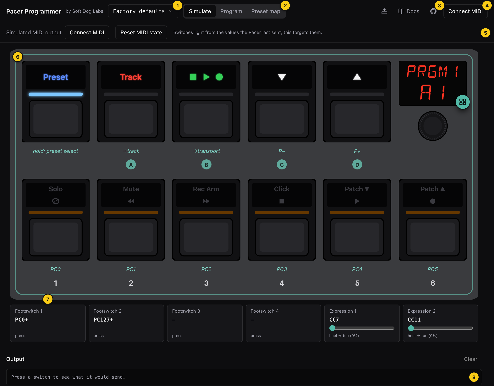

# The window

| | Region | What it's for |
|---|---|---|
| 1 | Configuration | The name of the configuration that's open. Click it to open the [device drawer](devices-and-files.md), where you pull from your Pacer, import or export a `.syx`, and open saved snapshots. |
| 2 | Mode bar | Switches between [Simulate](simulate-mode.md), [Program](program-mode.md) and the [Preset map](preset-map.md). |
| 3 | Docs | Opens these docs in a new tab, so you can follow along beside the app. |
| 4 | Device slot | Asks the browser for MIDI access. Once you've granted it, this shows whether your Pacer is there (see below). |
| 5 | Context bar | The controls for the current mode, so it changes when the mode does (see below). |
| 6 | Faceplate | The on-screen Pacer. In Simulate you play it, and in Program you tap a control to program it. See [The faceplate](the-faceplate.md). |
| 7 | Rear jacks | The four external footswitches and two expression pedals that plug into the back of the unit. |
| 8 | Output log | Every press and what it sent, newest first. **Clear** empties it. |

## The three modes

| Mode | What you do there |
|---|---|
| Simulate | Play the on-screen Pacer. Every press does what the real one would: the lights change, presets change, and MIDI goes out, to real gear if you like. |
| Program | Change what the presets do. Tap a control to edit it, rename the preset on the display, and send your changes to the Pacer. |
| Preset map | See how your presets lead to one another, and change those routes. |

All three work on the same configuration and the same current preset. A
change you make in Program is what Simulate plays, and choosing a preset on
the map loads it everywhere.

Your browser's Back and Forward buttons move between the places you've been:
the modes, the switch you were editing, and the device drawer.

## The device slot

| It shows | Meaning |
|---|---|
| Connect MIDI | The browser hasn't been asked for MIDI access yet. Click it, and the browser asks whether to allow MIDI (and SysEx, which the Pacer needs). |
| Pacer connected | MIDI access is granted and a Pacer is on USB. Click it to see its ports and firmware in the device drawer. |
| No Pacer found | MIDI access is granted but no Pacer is plugged in, or its ports aren't chosen. Click it to choose them. |
| Web MIDI isn't available in this browser | Use a browser that supports Web MIDI with SysEx. |
| MIDI access denied | The browser refused. **Retry** asks again, though you may need to allow MIDI in the site settings first. |

You don't need MIDI to program or to play the simulator on screen. MIDI is
only for sending to real gear and for talking to the Pacer.

## The context bar

### In Simulate

**Simulated MIDI output** is where the simulator sends its MIDI: your guitar
processor, synth or DAW. The default, *Don't send*, keeps everything on
screen. Until you've granted MIDI access, a **Connect MIDI** button sits in
its place.

If the browser granted MIDI without SysEx, you'll see **SysEx off**. MMC
messages (which are SysEx) won't be sent, and the Pacer can't be read or
written.

**Reset MIDI state** makes the simulator forget the values it has sent. The
Pacer remembers the last value it sent on each controller, note and program,
and its lights follow that memory, so after a reset the switches light the way
they would from a fresh start.

Keep in mind that this output isn't the Pacer. The simulator sends out to your
rig, the way the Pacer would, and you reach the Pacer itself through the device
drawer. See [The simulator](../guide/the-simulator.md).

### In Program

- **Undo** and **Redo**, or ⌘Z and ⇧⌘Z (Ctrl on Windows). The shortcuts don't
  apply while you're typing in a field.
- **Changes: All N presets / A3 only** (with your preset's slot in place of
  A3) only appears when the preset you're on is one of several that behave
  alike. See
  [Editing a state](program-mode.md#editing-a-state-several-presets-at-once).
- **unsaved** means you've changed something since the configuration was
  opened or last saved.
- **Save…** keeps the configuration as a snapshot in this browser. Nothing is
  sent to the Pacer.
- **Send to Pacer…** writes your changes to the Pacer. See
  [Sending to the Pacer](devices-and-files.md#sending-to-the-pacer).

### On the preset map

The map's context bar has the preset chooser, showing the current preset
(click it to choose another; see
[The preset chooser](the-faceplate.md#the-preset-chooser)). It also has the
same editing controls as Program, since rerouting on the map is editing too.
