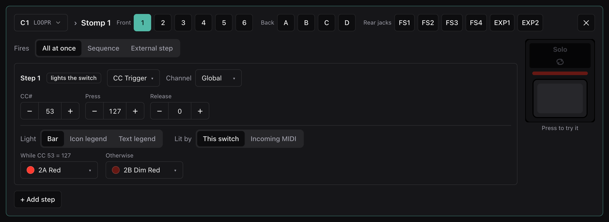
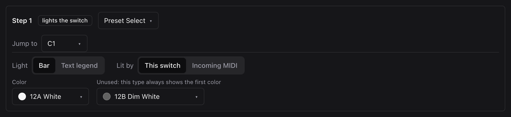
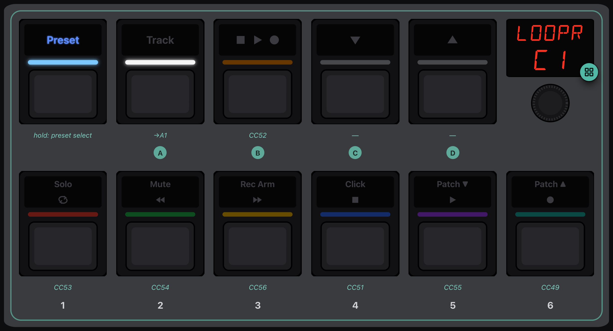
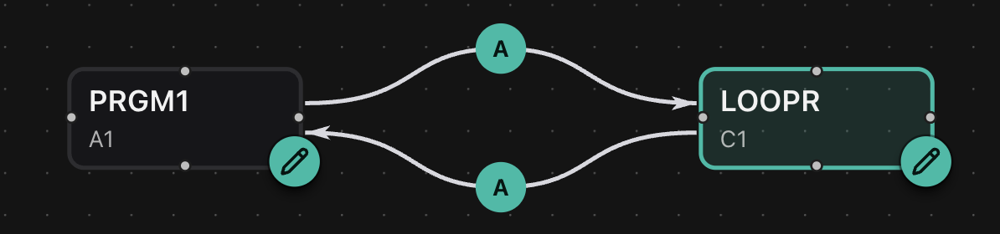

# 1. A looper preset

In this tutorial we'll turn C1 into a preset that drives the Quad Cortex's
looper, and make switch A on A1 lead to it and back. When we're done, the map
will show the two presets and the switch that connects them.

Start from the factory defaults: open the
[device drawer](../reference/devices-and-files.md#the-device-drawer) and click
**Factory defaults**.

## Make room in C1

1. Switch to **Program**.
2. Click the badge on the lower half of the display and choose **C1**.
3. Under the faceplate, click **Clear preset…** and confirm. C1 is now called
   `EMPTY`, and none of its switches do anything.
4. Tap the small pencil next to `EMPTY` on the display, type `LOOPR`, and
   press Enter.

## Put the looper on the switches

Tap switch **1**. In the editor:

1. Set the step type to **CC Trigger**. It sends one value when you press and
   another when you let go, which is what a looper's buttons expect.
2. Set **CC#** to `53`, **Press** to `127` and **Release** to `0`. Leave the
   channel on *Global*.
3. For the colours, pick **2A Red** for *While CC 53 = 127* and **2B Dim Red**
   for *Otherwise*. The switch will sit at dim red and flash bright while you
   press it.

Press the live switch on the right to try it. The log shows CC 53 = 127, then
CC 53 = 0.

Now do the rest, using the switch picker at the top to move between them:

| Switch | CC | Colours |
|---|---|---|
| 1 | 53 | 2A Red / 2B Dim Red |
| 2 | 54 | 7A Green / 7B Dim Green |
| 3 | 56 | 4A Amber / 4B Dim Amber |
| 4 | 51 | 9A Blue / 9B Dim Blue |
| 5 | 55 | 11A Purple / 11B Dim Purple |
| 6 | 49 | 8A Teal / 8B Dim Teal |
| B | 52 | 3A Orange / 3B Dim Orange |

These are the CCs my Quad Cortex uses for its looper functions. Check them
against the MIDI chart for your own unit and firmware, and put each function on
whichever switch you'd want under your foot.

## The way back

Tap switch **A**. Set its step to **Preset Select**, set **Jump to** to `A1`,
and set its colour to **12A White**. Now pressing A on LOOPR takes you back to
A1.

## The way in

Choose **A1** (the breadcrumb at the top of the editor is the same chooser) and
tap its switch **A**. In the factory set it's already a Preset Select, pointing
at the firmware's Track preset. Change **Jump to** to `C1`, and set its colour
to **12A White**:

## Try it

Close the editor and switch to **Simulate**. On A1, press **A**. The display
reads `LOOPR`, and the looper's switches glow in their colours.

Press a few switches and watch the log (or your looper, if you've chosen a
simulated MIDI output). Press **A** to go back to A1.

## On the map

Switch to **Preset map**:

There are your two presets, with switch A leading each way. The other factory
presets stand alone, because the only routes they have are next/previous
stepping, and the map leaves those out.

You might notice that LOOPR's A is drawn as going to A1, rather than as going
back. With only one way in, those mean the same thing, and the Pacer's
configuration has no way to say which one you meant. In the
[next tutorial](2-a-second-way-in.md), it has to decide.

If you want to keep what you've built, click **Save…** now.
