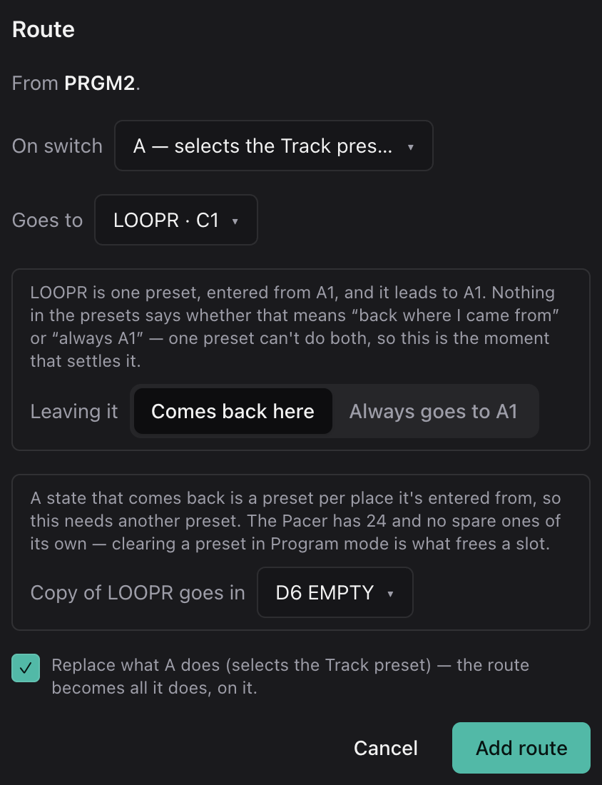
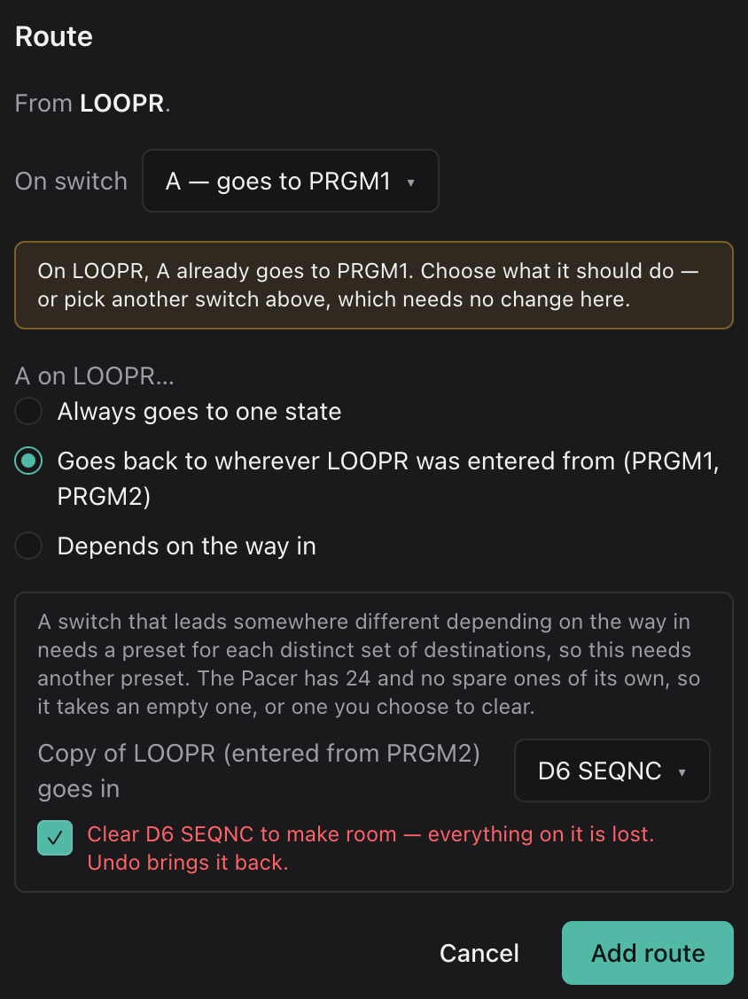
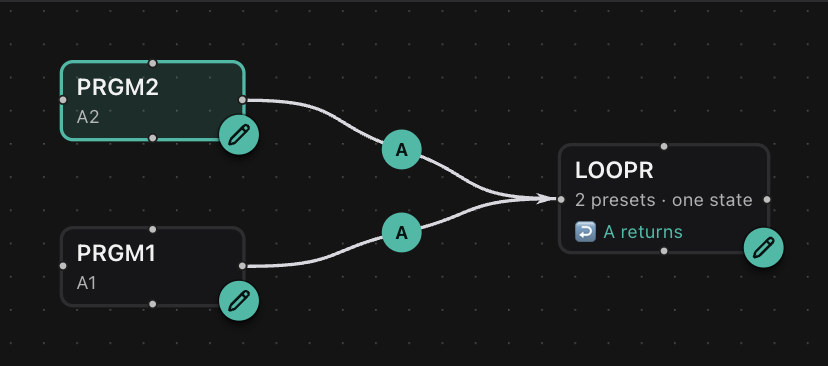
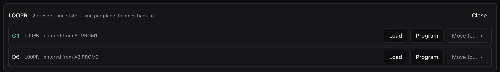

# 2. A Second Way In

Now say you'd like the looper from A2 as well. Pressing A on A2 should open
it, and pressing A on the looper should bring you back to A2, not to A1.

The Pacer can't do that with one preset. Switch A on a preset jumps to one
fixed place, and nothing on the Pacer remembers where you came from. The usual
fix is a second copy of the looper whose A goes back to A2, and then keeping
the two copies identical by hand from then on. Here, the map does that for
you.

This picks up where [tutorial 1](1-a-looper-preset.md) left off.

## Draw the Way In

1. Switch to **Preset map**.
2. Drag from the dot on the right edge of **PRGM2** to **LOOPR**, and let go.
   The route dialog opens.
3. For **On switch**, choose **A — selects the Track preset**, and tick
   **Replace what A does**. That way A2's switch A stops selecting Track and
   only goes to the looper.

Click **Add route**. That one's free. Going *into* a state never needs a copy,
so PRGM2 now leads to the same C1 that PRGM1 does. If you try it now, A on
the looper still takes you to A1, whichever way you came in.

## Make A Go Back

Now drag from **LOOPR** to **PRGM2**. The dialog opens on the first free
switch, and that would be fine if you wanted a second switch for getting back
to A2. It needs no copy at all. But we want A to do it, so:

1. For **On switch**, choose **A — goes to PRGM1**. The dialog points out that
   A already goes to PRGM1 and asks what it should do instead.
2. Choose **Goes back to wherever LOOPR was entered from (PRGM1, PRGM2)**.
3. A switch that has to lead somewhere different depending on how you got
   there is the one thing that takes a second copy, and the copy needs a
   preset of its own. The Pacer doesn't have any empty ones, so the dialog
   says **No empty presets left. Choose one to clear.**
4. For **Copy of LOOPR (entered from PRGM2) goes in**, choose **D6 SEQNC**.
   It's listed under **In use — would be cleared**, along with every other
   preset that no route leads to or from.
5. Tick **Clear D6 SEQNC to make room**. Everything on D6 goes, so the dialog
   won't do it until you've said so.

If you'd already cleared a preset in **Program**, it would be offered first,
under **Empty**, and there'd be nothing to tick.

Click **Add route**. Clicking the existing A route from LOOPR to PRGM1 gets
you the same choice, if that's how you'd rather get there.

## One State, Two Presets

LOOPR is still a single box, labelled **2 presets · one state**, and it's
marked **↩ A returns**, which means its switch A takes you back to wherever you
came from. The dashed lines back to PRGM1 and PRGM2 are that same switch: one
switch that goes to either, depending on how you got in. Click LOOPR to see
what it's made of:

C1 is entered from A1, and D6 from A2. The two are identical except for switch
A, which on each copy leads back to its own origin.

## Try It

In **Simulate**, choose A2 and press **A**. The display shows `LOOPR`, and
you're on D6. Press **A** again and you're back on A2. From A1 you get C1, and
it takes you back to A1.

## More Ways In

Every new way into a state that returns costs one more copy, and so one more
slot. Twelve main presets that each open the looper would need twelve copies,
and twelve mains plus twelve copies fills all 24 slots. The map works out the
cost before it writes anything, asks you for a slot each time, and won't build
a design that doesn't fit. See [Slot budget](../reference/preset-map.md#slot-budget).

A state that doesn't come back costs nothing extra, however many ways in it
has. A tuner whose A always goes to A1 stays one preset. So does a looper that
gets back to each main on its own switch, since each switch only ever goes one
place. If you change your mind, click **↩ A returns** on LOOPR and choose
**Always goes to one state**. The copy D6 isn't needed any more, so it's
cleared and freed.
