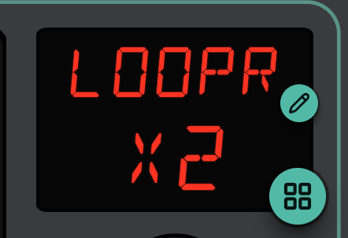
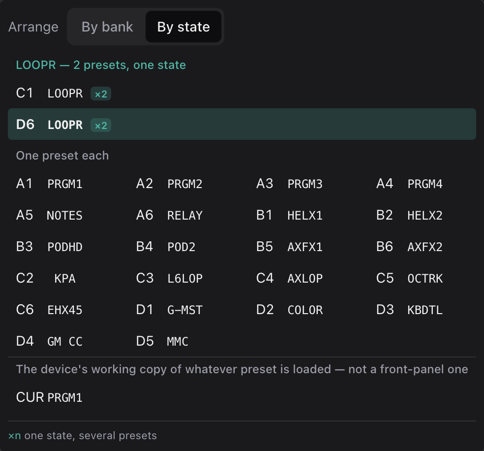

# 3. Changing the Looper

The looper is now two presets, C1 and D6. If you were doing this by hand,
every change would have to be made twice, and the day you forgot, the copies
would start to drift apart. Here you change the state, and the copies follow.

This picks up where [tutorial 2](2-a-second-way-in.md) left off.

## Edit Once

In **Program**, choose **D6** (C1 works just as well, since either one is the
looper). The app tells you in three places that you're editing more than one
preset.

The context bar shows **Changes: All 2 presets**, already selected:

The display shows how many presets you're editing, where the preset number
would normally be:

And the preset panel underneath names them: *D6 is one of 2 presets that
behave alike, "LOOPR" on the map (C1, D6).*

Now make a change. Tap switch **6** and set its colours to **10A Lavender**
and **10B Dim Lavender**. Then choose C1, and you'll see its switch 6 is
lavender too. The same goes for anything else you change, whether it's a CC, a
step, the name, or the MIDI sent on load.

There's one thing that stays per preset, and that's where a jump leads. Switch
A's target is what tells the copies apart, so it's only edited on the copy in
front of you. If you want to change routes, do it on the map, which keeps every
copy's way back straight.

## See the Copies

The [preset chooser](../reference/the-faceplate.md#the-preset-chooser) has a
**By state** view that groups them together:

## Editing One Copy on Purpose

If you choose **D6 only**, your edits go to D6 alone. As soon as it differs
from C1 in anything other than its jumps, it isn't the same state anymore.
The map will show two looper boxes, and D6's A becomes an ordinary jump to A2.
Sometimes that's what you want (a looper variant for one song, say), but it's
a different design, so the app never makes that choice for you.

## Tidy Up the Slots

Copies land wherever there was room. If you'd like them together, say with the
whole looper in bank D, click LOOPR on the map and use **Move to…** on a copy.
The switches that lead to it follow it to its new slot. Only empty presets are
offered, so you may need to clear one first.
